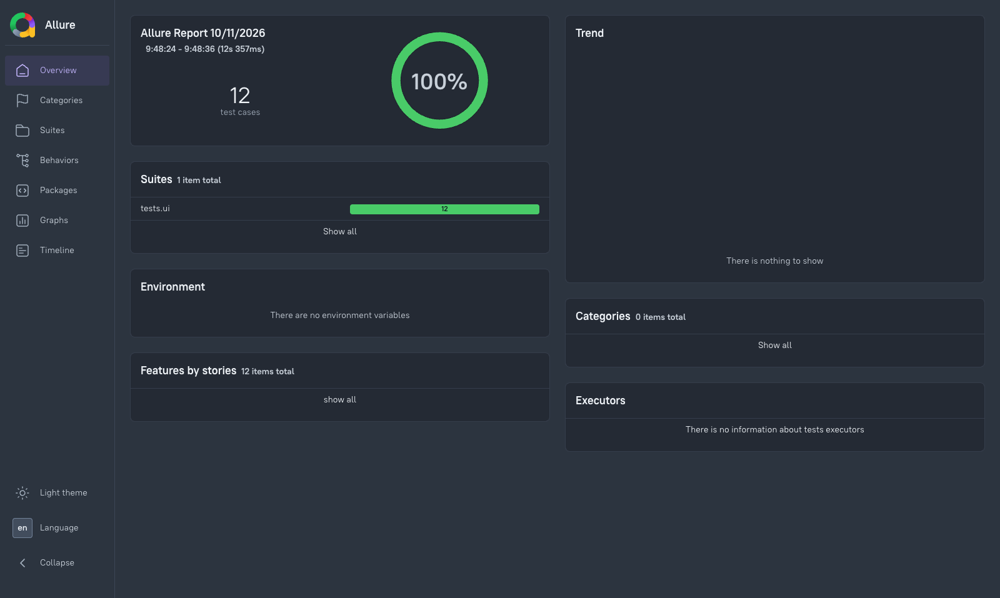
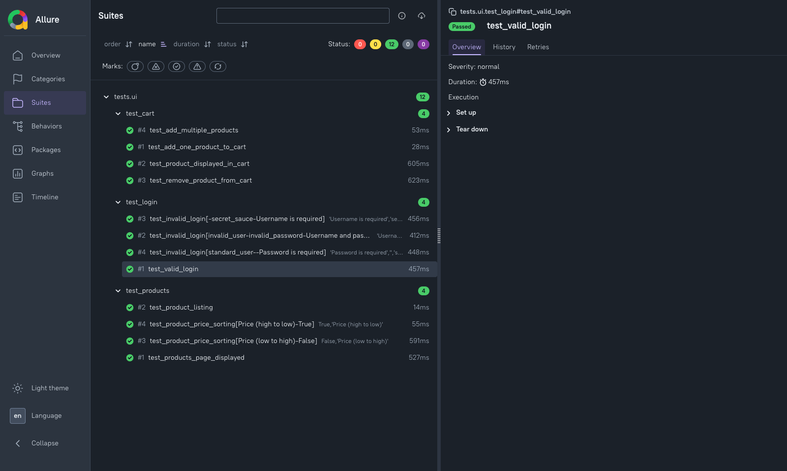

# Test Execution Report — TestSphere-Automation

## 1. Project Overview

| Field | Details |
|---|---|
| Project Name | TestSphere-Automation |
| Application Under Test | SauceDemo E-commerce Application |
| Testing Type | UI Functional and Regression Testing |
| Automation Framework | Selenium WebDriver, Python, PyTest, Page Object Model (POM) |
| Reporting Tool | Allure Report |
| Defect Tracking | Jira |
| Execution Period | October 2026 |
| Execution Status | Passed |

## 2. Test Execution Summary

| Metric | Result |
|---|---:|
| Total Tests Executed | 12 |
| Passed | 12 |
| Failed | 0 |
| Skipped | 0 |
| Pass Rate | 100% |

**Execution Result:** All 12 automated UI tests passed in the latest recorded regression run.

## 3. Test Execution Results

| Module | Test Scenarios | Total | Passed | Failed |
|---|---|---:|---:|---:|
| Login | Valid login, invalid credentials, empty username, empty password | 4 | 4 | 0 |
| Products | Products page validation, product listing, price sorting (low-to-high and high-to-low) | 4 | 4 | 0 |
| Cart | Add product, verify cart contents, remove product, add multiple products | 4 | 4 | 0 |
| **Total** | | **12** | **12** | **0** |

## 4. Test Environment

| Component | Configuration |
|---|---|
| Operating System | macOS |
| Browser | Google Chrome |
| Programming Language | Python 3.13.5 |
| Selenium WebDriver | 4.50.0 |
| PyTest | 9.1.1 |
| Design Pattern | Page Object Model |
| Reporting | Allure PyTest |
| Defect Management | Jira |

## 5. Test Execution Commands

**Execute all UI tests with Allure reporting:**

```bash
python -m pytest tests/ui/ -v --alluredir=allure-results --clean-alluredir
```

**View the Allure report:**

```bash
allure serve allure-results
```

## 6. Allure Test Report Screenshots

### 6.1 Allure Overview

The Allure Overview dashboard summarizes test execution status, passed and failed tests, and overall execution results.



### 6.2 Allure Test Results

The Allure test results view provides details about executed test cases and their outcomes.



*Note: Add the actual screenshots to `docs/screenshots/` before publishing. These images are placeholders until the files are added.*

## 7. Defect and Debugging Summary

| Issue ID | Description | Category | Status |
|---|---|---|---|
| KAN-4 | Cart Navigation Synchronization Failure | Automation Framework / Synchronization | Done |

**Resolution:** Added an explicit wait to verify the `"Your Cart"` heading after navigation.

Additional intermittent browser and test reliability issues were investigated and documented in [DebuggingIssues.md](DebuggingIssues.md). Their exact root causes were not conclusively established.

## 8. Execution Conclusion

The latest recorded UI regression execution completed successfully with **12 passed, 0 failed, and a 100% pass rate**.

The automated test suite validates core SauceDemo functionality across Login, Products, and Cart modules.

Allure provides detailed execution reporting, while Jira supports defect tracking and resolution.

**Overall Result: PASS**

*This report represents the latest recorded UI test execution, not a claim that every possible application scenario has been tested.*
